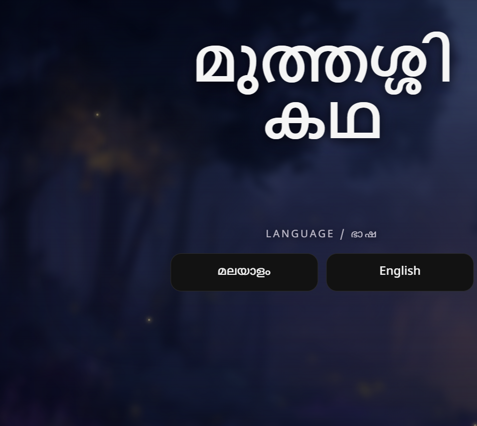
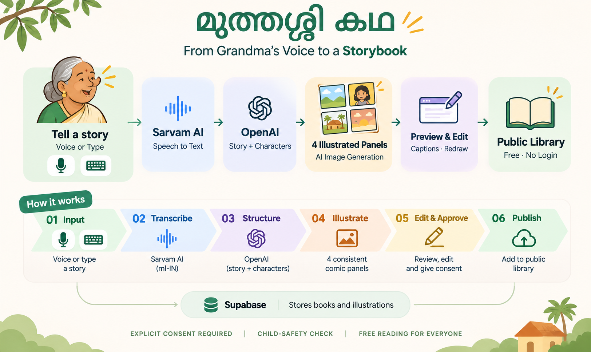
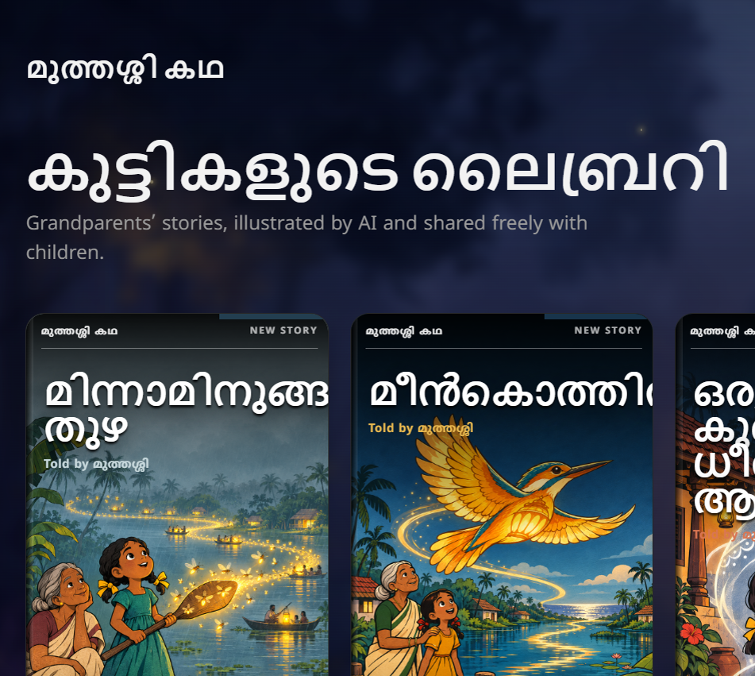
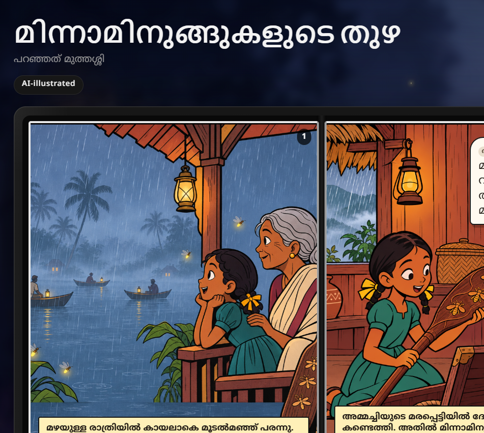

# മുത്തശ്ശി കഥ

### Muthashi Kadha

**Grandmothers become authors. Every child gets a free story library.**

Muthashi Kadha turns a spoken Malayalam story into an illustrated bilingual comic book. The storyteller can review it, edit it, and share it with children through a public library.

[Try the live app](https://muthashi-kadha.vercel.app/) | [Open the library](https://muthashi-kadha.vercel.app/library)

<p align="center">
  <a href="https://muthashi-kadha.vercel.app/">
    
  </a>
</p>

## The problem

Kerala's elders hold family memories, local tales, and folklore that often remain only in speech.

They already know how to tell stories. The hard part is everything that comes after:

- typing Malayalam
- writing for children
- drawing and laying out a book
- publishing it online
- sharing it safely

Muthashi Kadha removes those barriers. A spoken story becomes a book that the storyteller still controls.

## How it works

1. Tell a story in Malayalam, Manglish, or English.
2. Review the transcript and fix any words.
3. Generate a four-panel bilingual comic.
4. Review the cover, narration, and dialogue.
5. Edit any text or redraw a panel.
6. Give clear consent before publishing.
7. Share the book with a public link and QR code.

<p align="center">
  
</p>

## What is working

- Malayalam voice recording and transcription
- Typed input as a fallback
- Malayalam and English titles, narration, and dialogue
- Four comic panels generated in parallel
- A separate portrait cover
- Live cover activity during image generation
- Crisp HTML and SVG speech bubbles
- Malayalam text rendered outside generated images
- Editable title, narration, and dialogue
- Per-panel image redraw
- Two-page comic reader
- Full-screen reading mode
- Explicit consent before publishing
- Final child-safety check
- Public story library
- Public book links and QR codes
- Mobile layout and reduced-motion support

## Screenshots

### Public library

Newly published books appear in the library. Children can read them without an account.



### Comic reader

Each book has a cover, two-page spreads, narration, speech bubbles, and a Malayalam or English language switch.



## Why text is not generated inside the images

Image models often misspell words and break Malayalam characters.

This app asks the image model for clean artwork only. It renders narration and dialogue with HTML, CSS, SVG, and Noto Sans Malayalam.

This keeps the text:

- readable
- editable
- selectable
- bilingual
- independent of the image provider

## Tech stack

- [Next.js](https://nextjs.org/) App Router
- React and TypeScript
- Tailwind CSS
- [Sarvam AI](https://www.sarvam.ai/) for Malayalam speech-to-text
- OpenAI language and image models
- [Supabase](https://supabase.com/) Postgres and Storage
- Vercel
- Noto Sans Malayalam

All AI calls run on the server. API keys are not sent to the browser.

## Main pipeline

```text
Voice or typed story
        |
        v
Malayalam transcription
        |
        v
Structured bilingual story JSON
        |
        +----> Portrait cover image
        |
        +----> Four text-free panel images
        |
        v
HTML comic text and speech bubbles
        |
        v
Review, edit, consent, safety check
        |
        v
Public library and QR link
```

## Project structure

```text
app/
  api/
    books/          Save and edit books
    cover/          Generate cover artwork
    library/        Read public books
    panel/          Generate panel artwork
    publish/        Run safety checks and publish
    qr/             Generate public QR codes
    story/          Turn a transcript into story JSON
    transcribe/     Start and check transcription
  book/[id]/        Public and private book reader
  create/           Story creation flow
  library/          Public library

components/
  BookCover.tsx
  BookFlip.tsx
  ComicPanel.tsx
  CoverStudio.tsx
  CreateFlow.tsx
  NarrationBox.tsx
  SpeechBubble.tsx

lib/
  comic-layout.ts
  normalize-story.ts
  prompts.ts
  supabase.ts
  types.ts

supabase/migrations/
```

## Run locally

### 1. Install packages

```bash
npm install
```

### 2. Add environment variables

Copy `.env.example` to `.env.local` and fill in the values:

```env
OPENAI_API_KEY=
LLM_MODEL=
IMAGE_MODEL=
SARVAM_API_KEY=
NEXT_PUBLIC_SUPABASE_URL=
NEXT_PUBLIC_SUPABASE_ANON_KEY=
SUPABASE_SERVICE_ROLE_KEY=
NEXT_PUBLIC_SITE_URL=
DEMO_MODE=false
```

Use a public URL for `NEXT_PUBLIC_SITE_URL` in production. QR codes reject localhost links.

### 3. Set up Supabase

Run the SQL files in `supabase/migrations/` against your Supabase project.

Create a public Storage bucket named `panels`.

### 4. Start the app

```bash
npm run dev
```

Open [http://localhost:3000](http://localhost:3000).

## Useful commands

```bash
npm run dev
npm run lint
npm run build
npm run start
```

## Safety and privacy

- A book is private until the storyteller gives consent.
- Final titles, narration, and dialogue are checked before publishing.
- The story prompt removes or generalises personal details.
- Public book responses do not include the raw original story.
- Every book is marked as AI-illustrated.
- Demo stories are marked as demo content.

This is a hackathon prototype. A real public launch needs human moderation, image checks, reporting, deletion, ownership controls, and a clear data-retention policy.

## Current limits

- Image generation can take one to two minutes.
- Character consistency is improved by prompts and style references, but it is not guaranteed.
- Speech recognition may need corrections for dialects or noisy rooms.
- The public library does not yet have search, reports, or age filters.
- The prototype does not have accounts or self-service unpublish.
- Automatic safety checks are not a replacement for human review.

## Next steps

1. Test with real senior storytellers and children.
2. Add Malayalam read-aloud narration.
3. Add secure ownership, deletion, and unpublish.
4. Add human moderation and reporting.
5. Improve character consistency.
6. Add school and library curation tools.

## Hackathon

Built for the **BIA GenAI Hackathon 2026** under the theme **AI for Inclusive Kerala**.

The core idea is simple:

> We are not teaching elders how to tell stories. We are removing everything standing between their voice and the next generation.
